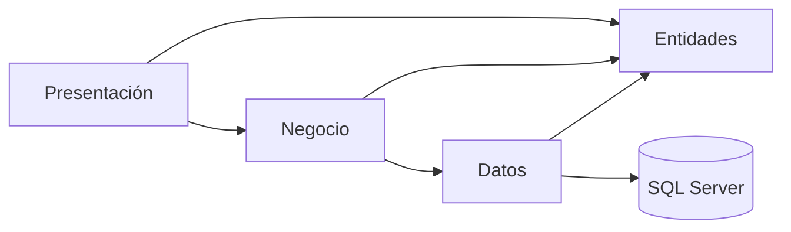

# Forza Suplementos

Aplicación académica de escritorio para gestionar ventas de suplementos, clientes, productos, usuarios y caja. Desarrollada para Taller de Programación II de la Licenciatura en Sistemas de Información de la UNNE.

## Tecnologías

- Visual Basic .NET y Windows Forms.
- .NET Framework 4.7.2.
- Visual Studio Community con desarrollo de escritorio .NET y soporte para soluciones SLNX.
- SQL Server y SQL Server Management Studio (SSMS).
- ADO.NET / System.Data.SqlClient y procedimientos almacenados parametrizados.
- Git y PowerShell para compilación y ensayos reproducibles.

## Arquitectura

La solución conserva cuatro proyectos:

- **Presentación:** formularios, controles y coordinación de la interacción del usuario.
- **Entidades:** modelos de usuario, producto, cliente, venta, detalle y sesión de caja.
- **Negocio:** validaciones y reglas de operación.
- **Datos:** conexiones, parámetros y ejecución de procedimientos almacenados.



El SQL de negocio permanece fuera de los formularios. La comprobación del entorno QA se realiza en la infraestructura de conexión.

## Funcionalidades

- Inicio y cierre de sesión con perfiles.
- Altas, modificaciones, bajas lógicas y reactivación de usuarios, productos y clientes.
- Carrito y registro de ventas con actualización de stock.
- Apertura y cierre de una caja física, historial por fecha y reporte de sesión.
- Un medio de pago explícito por venta: efectivo, transferencia o tarjeta.
- Efectivo esperado calculado como inicial más pagos en efectivo; tarjetas y transferencias quedan fuera de ese saldo.
- Transacción SQL que integra cabecera, detalles, pago y stock; rechazo por caja cerrada, cantidad inválida o stock insuficiente.
- Reportes de ventas, ventas propias y bajo stock.
- Flujo de backup en el entorno habitual; el backup físico está bloqueado expresamente en QA.

### Perfiles de referencia

- **Administrador:** usuarios y respaldos. No vende ni opera caja.
- **Gerente:** productos y reportes globales. No vende ni opera caja.
- **Vendedor:** ventas, clientes, caja y consulta de resultados propios.

Los filtros avanzados de reportes están habilitados en QA mediante 004; el refuerzo global de autorización de módulos anteriores conserva los límites documentados. Caja y Ventas verifican el perfil tanto en negocio como en SQL.

## Estructura del repositorio

```text
ForzaSuplementos/ForzaSuplementos/
  ForzaSuplementos.slnx
  ForzaSuplementos.Presentacion/
  ForzaSuplementos.Entidades/
  ForzaSuplementos.Negocio/
  ForzaSuplementos.Datos/
config/                 # Plantilla de configuración QA sin secretos
scripts/                # Compilación y herramientas
sql/migrations/         # Migraciones de Caja
sql/qa/                 # Esquema y migraciones protegidas de QA
tests/                  # Reglas, contratos e integración
docs/                   # Diagnóstico, resultados e instrucciones
```

## Requisitos

1. Windows con .NET Framework 4.7.2 y su Developer/Targeting Pack.
2. Visual Studio con soporte para `.slnx` y MSBuild. La validación registrada usó MSBuild 18.11.1.
3. SQL Server 2016 SP1 o posterior para `CREATE OR ALTER`; el entorno QA registrado utilizó SQL Server 17.x.
4. SSMS y `sqlcmd` para preparar un entorno aislado.
5. Windows PowerShell 5.1. ScriptDom es necesario para los validadores estáticos; se localiza con vswhere o se indica con `-ScriptDomPath`.
6. Git. Python 3.9 o posterior es opcional para la auditoría local del historial.

## Instalación y compilación

Abrir una terminal en la carpeta del clon o de la copia local. Los comandos siguientes son relativos a esa carpeta, no requieren la ruta personal del desarrollador.

```powershell
powershell -NoProfile -ExecutionPolicy RemoteSigned -File .\scripts\compilar.ps1
```

También puede abrirse `ForzaSuplementos/ForzaSuplementos/ForzaSuplementos.slnx` en Visual Studio y elegir **Debug / Any CPU > Recompilar solución**.

RemoteSigned se aplica solo al proceso PowerShell iniciado, sin cambiar la política permanente. No hay paquetes externos de ejecución que restaurar para las cuatro capas actuales.

## Configurar una base QA independiente

No se distribuyen backups, archivos de base, personas reales ni contraseñas. La instalación habitual no se crea automáticamente: para ensayar, usar exclusivamente la base independiente `ForzaSuplementosDB_QA`.

1. Copiar la plantilla local, sin agregar la copia a Git:

   ```powershell
   Copy-Item .\config\qa.example.config .\config\qa.config
   ```

2. En SSMS, confirmar la instancia deseada mediante una consulta de lectura:

   ```sql
   SELECT SERVERPROPERTY('ServerName') AS servidor,
          SERVERPROPERTY('InstanceName') AS instancia,
          DB_NAME() AS baseActual;
   ```

3. Editar `config/qa.config`: `servidor` es la instancia de conexión y `servidorEsperado` debe ser exactamente el servidor verificado. Conservar el nombre QA y su marca. La plantilla incompleta se rechaza; no desactivar las guardas.

4. Ejecutar primero la verificación sin escrituras:

   ```powershell
   powershell -NoProfile -ExecutionPolicy RemoteSigned -File .\scripts\qa\Preparar-QA.ps1
   ```

5. Revisar [la guía SQL QA](sql/qa/README.md). Solo con autorización para ese servidor, crear QA, cargar estructura/datos ficticios y aplicar las migraciones:

   ```powershell
   powershell -NoProfile -ExecutionPolicy RemoteSigned -File .\scripts\qa\Preparar-QA.ps1 -AutorizarEscrituras
   ```

El preparador usa el destino local verificado como variable SQLCMD y comprueba servidor/base antes de cada archivo. No reemplaza una QA existente. No ejecutar estos scripts contra la base habitual ni sobre una base con datos reales.

## Ejecutar la aplicación contra QA

Definir una clave **nueva y ficticia** cuando la herramienta lo solicite; no se imprime ni se guarda en el repositorio:

```powershell
powershell -NoProfile -ExecutionPolicy RemoteSigned -File .\scripts\qa\Establecer-Clave-QA.ps1 -AutorizarEscrituras
powershell -NoProfile -ExecutionPolicy RemoteSigned -File .\scripts\qa\Iniciar-App-QA.ps1
```

Los usuarios sintéticos son `qa_vendedor`, `qa_vendedor2`, `qa_admin` y `qa_gerente`. El lanzador selecciona QA solo para el proceso hijo; no modifica la conexión habitual. Si falla la configuración QA, se detiene y no vuelve al entorno habitual.

Para estos ensayos no iniciar el EXE por doble clic ni usar F5 normal. El título principal identifica QA. Para depurar, usar **Asociar al proceso** de Visual Studio al PID informado por el lanzador. Ver [inicio desde Windows](docs/INICIAR_QA_WINDOWS.md).

## Pruebas y estado validado

```powershell
# Reglas locales; sin SQL
powershell -NoProfile -ExecutionPolicy RemoteSigned -File .\tests\Probar-Caja-SinSql.ps1

# Sintaxis, contratos y guardas; sin escrituras SQL
powershell -NoProfile -ExecutionPolicy RemoteSigned -File .\tests\qa\Validar-Preparacion-SinSql.ps1

# Integración; requiere QA preparada y autorización para datos ficticios
powershell -NoProfile -ExecutionPolicy RemoteSigned -File .\tests\qa\Invoke-Caja-QA.ps1 -Ejecutar -AutorizarEscrituras
```

La validación documentada aprobó 18 ensayos SQL, una prueba adicional de las DLL VB contra QA y 20 comprobaciones locales. Incluye rollback y dos ventas concurrentes sobre la última unidad. No equivale a una prueba de carga ni a validar toda interacción visual. Los resultados originales se describen en [RESULTADOS_QA.md](docs/RESULTADOS_QA.md); los identificadores del equipo fueron anonimizados para compartir la documentación.

## Seguridad y límites

- `config/qa.config`, exportaciones locales, artefactos y respaldos del historial están excluidos de Git. Publicar solo plantillas y datos ficticios.
- La conexión habitual usa autenticación integrada, sin usuario/contraseña SQL literal. No cambiarla para probar QA.
- La autenticación heredada de usuarios requiere reforzar el tratamiento de contraseñas. No usar datos ni claves reales en esta demostración.
- No se implementaron pagos divididos, devoluciones, retiros de caja, relevo de responsable ni idempotencia de reintentos.
- No repetir una venta de resultado ambiguo por pérdida de conexión sin comprobar antes su registro.

## Preparación de GitHub

El repositorio principal es [franconbenitez/ForzaSuplementos](https://github.com/franconbenitez/ForzaSuplementos), **privado**, rama `master`. Conserva los ocho commits saneados iniciales y las mejoras posteriores, sin importar referencias del historial original. Desarrollo_Codex permanece como respaldo. Los nuevos envíos requieren autorización. Ver [saneamiento](docs/SANEAMIENTO_GITHUB.md) y [trabajo en dos equipos](docs/PUBLICACION_PRIVADA_Y_USO_DIARIO.md).

No se asigna una licencia de distribución adicional en esta preparación.

## Buscadores de Ventas y QA principal

Ventas selecciona clientes y productos mediante búsqueda y grillas oscuras, con Enter, doble clic o Seleccionar. No modifica el carrito al buscar. En el equipo de desarrollo usar el acceso directo **FORZA SUPLEMENTOS - QA (GITHUB)**, dirigido al CMD del repositorio principal; qa.config permanece privada e ignorada. Ver [implementación, pruebas y pasos de QA](docs/BUSCADORES_VENTAS.md).

## Dashboards y esquema QA

[Inventario real](docs/INVENTARIO_BASE_DATOS.md) y [diagrama ER](docs/DIAGRAMA_ER.md): 11 tablas (10 de aplicación y qa.Fixtures), 11 FK y 30 SP después de aplicar 004 en QA. [Dashboards por perfil](docs/DASHBOARDS_REPORTES.md): evolución, unidades, rankings y auditoría habilitados y validados en QA mediante 004; cada instalación independiente requiere autorización para su migración. [Resultados y límites](docs/RESULTADOS_REPORTES_QA.md). No ejecutar migraciones ni fixtures sin autorización.
