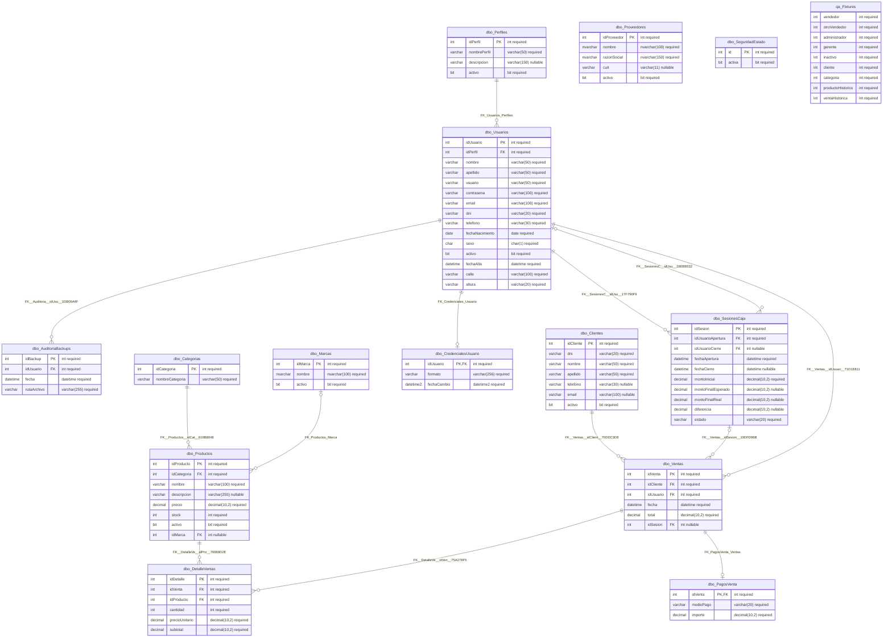

# Diagrama entidad-relación auditado

Fecha: 2026-10-31. Basado en las 13 FK reales de QA; no se deducen relaciones por semejanza de nombres. qa.Fixtures es auxiliar de pruebas y no tiene FK. Ver INVENTARIO_BASE_DATOS.md para tipos completos y restricciones.

La opcionalidad se obtiene de NULL en la FK; la cardinalidad uno a uno solo se usa cuando las columnas FK tienen unicidad real. Las dos relaciones Usuario/SesionCaja (apertura/cierre) se conservan por separado. No se dibuja qa.Fixtures como FK comercial.
