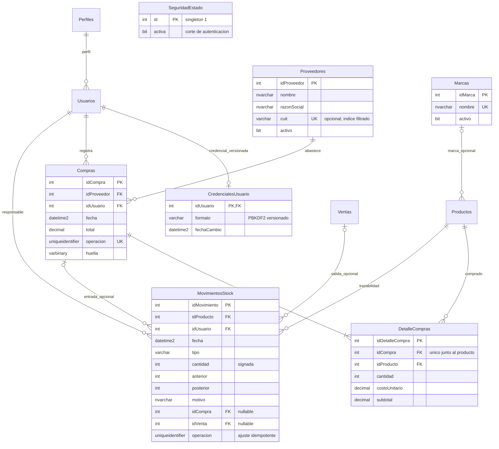

# Modelo proyectado — NO desplegado

El esquema QA real sigue en DIAGRAMA_ER.md: 11 tablas y 30 SP. Este diagrama representa únicamente las ampliaciones 005–008 propuestas. No confundirlo con un inventario de objetos existentes. Se proponen siete tablas adicionales, no se crearon en SQL Server.

Compras con al menos un detalle es una regla del SP, no una cardinalidad mínima garantizada por una FK. No hay FK comercial desde SeguridadEstado: es configuración singleton. Nuevas columnas propuestas: Perfiles.activo, Productos.idMarca nullable y Productos.stockMinimo no negativo.

No se crea stock inicial retroactivo ni movimientos de ventas históricas. Las compras conservan costo por línea; Productos.precio sigue siendo el precio de venta. Los índices se justifican por unicidad de CUIT/marca/operación, integridad de líneas y movimientos por origen, FK de marca y filtros por fecha/producto/proveedor. No se añadieron tablas solo para incrementar su cantidad.
